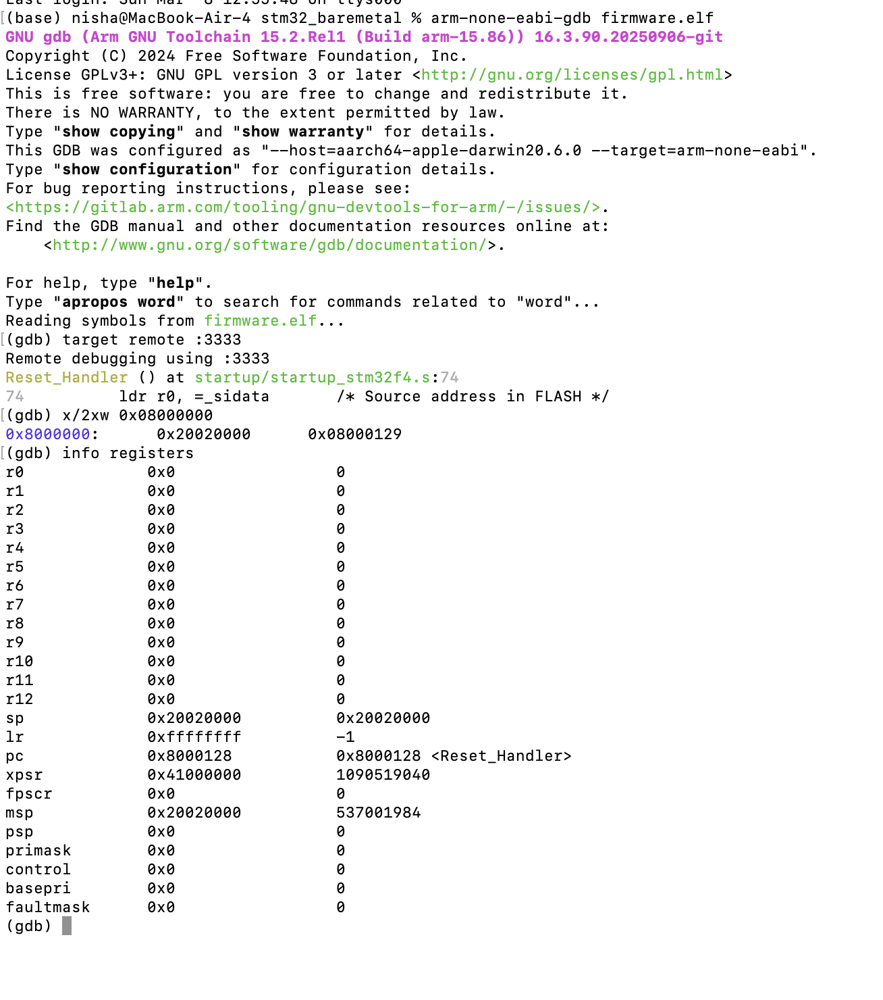
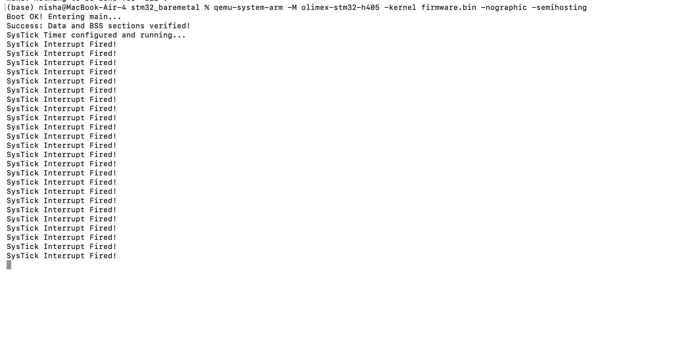
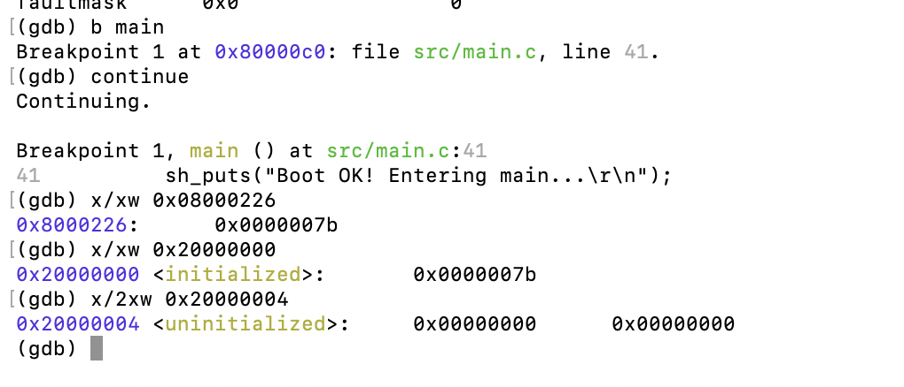

# STM32 QEMU Bare-Metal Project

* **Target:** STM32F405 (Cortex-M4)
* **Toolchain:** arm-none-eabi
* **Emulator:** QEMU (olimex-stm32-h405)
* **Submitted by:** Nishant (2025EET2634), Raj Fauzdar (2025EET2733), Himanshu Suryavanshi (2025EET2484)


## Memory Configuration (From firmware.map)

* **FLASH Origin** = `0x08000000` | **Length** = `0x00100000` (1 MB)
* **RAM Origin** = `0x20000000` | **Length** = `0x00020000` (128 KB)

**FLASH Address Range:**
`0x08000000` – `0x080FFFFF`

**RAM Address Range:**
`0x20000000` – `0x2001FFFF`

### Stack Pointer Calculation

```text
_estack = ORIGIN(RAM) + LENGTH(RAM)
        = 0x20000000 + 0x00020000
        = 0x20020000
```

**This value becomes the first entry in the vector table and is loaded into the SP register during CPU reset.**


## Section Placement (From Linker Map)

The linker script explicitly places the following sections:
* `.isr_vector` → FLASH start
* `.text` → FLASH (includes `.rodata`)
* `.data` → FLASH (load) → RAM (run)
* `.bss` → RAM

### Vector Table (`.isr_vector`)

* **Address:** `0x08000000`
* **Size:** `0x40` bytes

Placed at the start of FLASH as required by Cortex-M architecture. Contains the initial stack pointer and interrupt vector entries.

* **Symbol:** `g_pfnVectors` → `0x08000000`

Boot sequence begins from this location.

### Code Section (`.text` including `.rodata`)

* **Start Address:** `0x08000040`
* **Size:** `0x1E6` bytes

Important functions located here:
* `SysTick_Handler` → `0x0800007C`
* `main` → `0x080000BC`
* `Reset_Handler` → `0x08000128`

This confirms that executable code resides entirely in FLASH.

### Read-Only Data (`.rodata`)

* **Start Address:** `0x08000170`
* **Size:** `0xB6` bytes

Contains constant data such as string literals.
* *Example:* "Boot OK"

Immediately after the `.text` section, the linker defines: `_sidata = 0x08000226`
This is the FLASH load address of the `.data` section.

### Initialized Data (`.data`)

* **Run Address (VMA):** `0x20000000`
* **Load Address (LMA):** `0x08000226`
* **Size:** `0x4` bytes

**Symbols:**
* `_sdata` = `0x20000000`
* `_edata` = `0x20000004`

Variables with initial values are stored in FLASH and copied to RAM during system startup.
* *Example variable:* `initialized` → located at `0x20000000`

### Uninitialized Data (`.bss`)

* **Start Address:** `0x20000004`
* **Size:** `0x8` bytes

**Symbols:**
* `_sbss` = `0x20000004`
* `_ebss` = `0x2000000C`

Variables inside this region:
* `systick_counter`
* `uninitialized`

These variables are cleared to zero during `Reset_Handler` execution.


## Flash Memory Usage Calculation

* `.isr_vector` = `0x40` bytes
* `.text` (includes `.rodata`) = `0x1E6` bytes

**Total FLASH used:**
`0x40` + `0x1E6` = `0x226` bytes
`0x226` (hex) = **550 bytes**

* Total FLASH available = 1 MB = 1,048,576 bytes
* FLASH used = 550 bytes
* FLASH utilization ≈ **0.05 %**

This confirms a very small program footprint.


## RAM Memory Usage Calculation

* `.data` = `0x4` bytes
* `.bss` = `0x8` bytes

**Total RAM used:**
`0x4` + `0x8` = `0xC` bytes
`0xC` (hex) = **12 bytes**

* Total RAM available = 128 KB = 131,072 bytes
* RAM used ≈ 12 bytes (+ stack)

This confirms correct RAM usage and no overlap.


## Load Address vs Run Address

From `firmware.map`:
`.data  0x20000000 load address 0x08000226`

**Meaning:**
* **Load Memory Address (LMA)** → FLASH
* **Virtual/Run Address (VMA)** → RAM

**Boot behavior:**
1. `Reset_Handler` reads `_sidata` (`0x08000226`)
2. Copies values from FLASH to RAM
3. Initializes memory between `_sdata` and `_edata`
4. Clears the `.bss` section between `_sbss` and `_ebss`

This process performs runtime initialization before `main()` runs.


## Boot Sequence

1. CPU reset occurs.
2. CPU reads initial stack pointer from address `0x08000000`.
3. Stack pointer is set to `0x20020000`.
4. Program counter is loaded with `Reset_Handler` address.
5. `Reset_Handler` begins execution.
6. Initialized data copied from FLASH (`0x08000226`) to RAM (`0x20000000`).
7. BSS memory region (`0x20000004`–`0x2000000C`) is cleared.
8. System initialization completes.
9. Execution branches to `main()`.
10. `main()` calls `sh_puts()`.
11. QEMU prints "Boot OK" using semihosting.


## QEMU Execution Commands

Before running QEMU Commands first run:
```bash
make clean
make
```

### Normal Run
```bash
qemu-system-arm -M olimex-stm32-h405 -kernel firmware.bin -nographic -semihosting
```

### Debug Mode
```bash
qemu-system-arm -M olimex-stm32-h405 -kernel firmware.bin -S -gdb tcp::3333 -nographic -semihosting
```


## GDB Debug Verification (Terminal 2)

### Vector Table Verification

**Command:**
```bash
arm-none-eabi-gdb firmware.elf
(gdb) target remote :3333
(gdb) x/2xw 0x08000000
```

**Output:**
```text
0x08000000:  0x20020000  0x08000129
```

**Explanation:**
* **First word → Initial Stack Pointer (`0x20020000`)**
  * RAM origin = `0x20000000`
  * RAM length = `0x00020000`
  * `_estack` = `0x20000000` + `0x00020000` = `0x20020000`
  * **This confirms:** ✔ Stack pointer initialized from vector table
* **Second word → Reset vector (`0x08000129`)**
  * From `firmware.map`: `Reset_Handler` = `0x08000128`
  * Vector table stores: `0x08000128` + `1` = `0x08000129`
  * The LSB = `1` indicates Thumb mode execution.
  * **This confirms:**
    * ✔ PC jumps to `Reset_Handler`
    * ✔ Thumb bit correctly set
    * ✔ Cortex-M execution mode correct

### Register Verification

**Command:**
```bash
(gdb) info registers
```

**Observed values:**
```text
sp = 0x20020000
pc = 0x08000128 <Reset_Handler>
```

This confirms the CPU correctly loaded the stack pointer and jumped to the `Reset_Handler`.

### Runtime Initialization Verification

```bash
(gdb) b main
(gdb) continue
```

#### `.data` Copy Verification

**FLASH value:**
```bash
(gdb) x/xw 0x08000226
```
**Output:**
```text
0x08000226: 0x0000007b
```

**RAM value:**
```bash
(gdb) x/xw 0x20000000
```
**Output:**
```text
0x20000000 <initialized>: 0x0000007b
```

Both values match. This confirms the `.data` section was correctly copied from FLASH to RAM during startup.

#### `.bss` Zero Initialization

**Command:**
```bash
(gdb) x/2xw 0x20000004
```

**Output:**
```text
0x20000004 <uninitialized>: 0x00000000 0x00000000
```

This confirms the `.bss` section was cleared correctly.

### Reference Images





## Linker Symbols

* `_estack` = `0x20020000`
* `_sidata` = `0x08000226`
* `_sdata`  = `0x20000000`
* `_edata`  = `0x20000004`
* `_sbss`   = `0x20000004`
* `_ebss`   = `0x2000000C`

These symbols are used by `Reset_Handler` to perform runtime memory initialization.


## SysTick Interrupt

* **SysTick_Handler address:** `0x0800007C`
* Located inside the `.text` section.

**This confirms:**
* ✔ Interrupt handler correctly linked
* ✔ Vector table entry correctly configured
* ✔ SysTick interrupt mechanism functional


## Project Demonstrates

* Custom linker script implementation
* Correct FLASH and RAM memory mapping
* Vector table placement at FLASH start
* Manual runtime initialization (`.data` copy and `.bss` clear)
* Correct LMA vs VMA handling
* Verified boot sequence
* QEMU execution with semihosting output
* GDB based debugging and validation